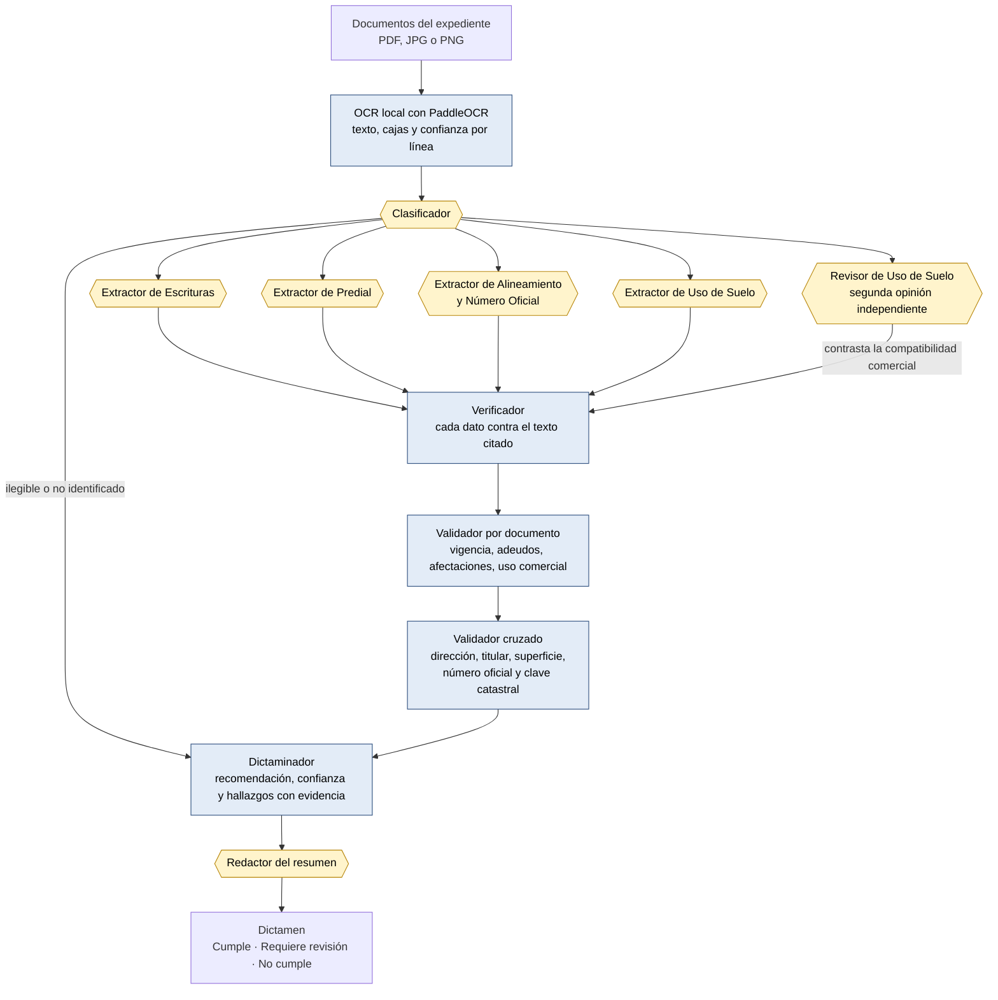

# Backend — Expedientes 3B

API en FastAPI que recibe los PDFs de un expediente, los lee con OCR local (PaddleOCR) y
entrega un dictamen con evidencia. Corre en una laptop; el front se conecta por HTTP.

> **Este repositorio es público.** Nunca subas PDFs, salidas de OCR ni llaves. `back/.env`,
> `back/data/` y `modules/` están en `.gitignore`.

## Instalación (Windows, Python 3.13)

Desde la carpeta `back/`:

```bash
python -m venv .venv
.venv\Scripts\python -m pip install --upgrade pip

# PaddlePaddle con GPU (NVIDIA, CUDA 12.6). Sin GPU: pip install paddlepaddle==3.3.1
.venv\Scripts\python -m pip install paddlepaddle-gpu==3.3.1 -i https://www.paddlepaddle.org.cn/packages/stable/cu126/

.venv\Scripts\python -m pip install -r requirements.txt
```

## Configuración

Copia `.env.example` como `.env` y rellena:

| Variable | Para qué |
|---|---|
| `API_KEY` | Clave que el front envía en la cabecera `X-API-Key`. Obligatoria |
| `CORS_ORIGINS` | URL(s) del front, separadas por coma |
| `DEEPSEEK_API_KEY` | Llave del LLM (se crea en portal.deploy.com, "Service API Keys") |
| `LLM_BASE_URL`, `LLM_MODEL` | Servicio y modelo; ya vienen puestos en `.env.example` |
| `OCR_DEVICE` | `gpu` o `cpu` |

## Ejecutar

```bash
.venv\Scripts\python -m uvicorn app.main:app --host 127.0.0.1 --port 8000
```

Documentación interactiva: http://127.0.0.1:8000/docs

Para que un front publicado en internet llegue al back hace falta un túnel con HTTPS
(por ejemplo `ngrok http 8000`) y poner la URL del front en `CORS_ORIGINS`.

## Rutas

Todas menos `/salud` piden la cabecera `X-API-Key` (o `?key=` en la URL, pensado para ``).

| Método y ruta | Qué hace |
|---|---|
| `GET /salud` | Comprueba que el servicio responde |
| `GET /ejemplo/expediente` | Expediente ficticio con dictamen completo, para desarrollar el front |
| `POST /expedientes` | Sube los documentos (campo `archivos`, uno o varios; PDF, JPG o PNG). Devuelve el expediente con su `id` |
| `GET /expedientes` | Lista de expedientes, sin el detalle del dictamen |
| `GET /expedientes/{id}` | Estado y avance; al terminar incluye el dictamen |
| `GET /expedientes/{id}/documentos/{doc_id}/paginas/{n}` | Imagen JPEG de la página |

El front consulta `GET /expedientes/{id}` cada pocos segundos hasta que `estado` sea `listo` o `error`.

### Evidencia

Cada evidencia trae `documento_id`, `pagina`, `texto` y `caja` (`[x0, y0, x1, y1]`).
La caja está en píxeles de la imagen de esa página; el tamaño real viene en
`documentos[].paginas[]` (`ancho`, `alto`) para escalar el resaltado.

El contrato completo está en `app/schemas.py` y en `/docs`.

## OCR por lote

Procesa una carpeta de PDFs y deja el resultado en caché, para que después el análisis sea rápido:

```bash
.venv\Scripts\python -m scripts.ocr_lote <carpeta_con_pdfs>
```

Solo imprime conteos y confianzas, no el contenido.

## Estructura

| Archivo | Contenido |
|---|---|
| `app/main.py` | Rutas, CORS y clave de acceso |
| `app/schemas.py` | Contrato JSON con el front |
| `app/ocr.py` | Rasterizado, PaddleOCR y caché por hash del PDF |
| `app/pipeline.py` | Proceso en segundo plano: OCR y análisis |
| `app/agentes.py` | Grafo de agentes (LangGraph) |
| `app/extraccion.py` | Clasificador, extractores, verificador y revisor |
| `app/validacion.py` | Reglas por documento, validaciones cruzadas y dictamen |
| `app/reglas.py` | Catálogo de reglas, efectos y utilidades de comparación |
| `app/llm.py` | Conexión al LLM |
| `app/ejemplo.py` | Expediente ficticio |
| `data/` | PDFs subidos y caché de OCR (no se sube al repo) |

## Agentes

Orquestados con LangGraph en `app/agentes.py`:



En amarillo, los agentes que leen y redactan con el LLM. En azul, los que deciden con reglas
explícitas en código: ninguna recomendación sale directamente del LLM. Si el extractor y el
revisor de uso de suelo no coinciden, el dato queda como no determinable y pasa a revisión.

| Agente | Qué hace | Cómo |
|---|---|---|
| Clasificador | Identifica el tipo de cada documento | Palabras clave; LLM si hay duda |
| Extractores | Sacan los datos de cada tipo citando las líneas de origen | LLM con esquema por tipo |
| Revisor de uso de suelo | Segunda opinión independiente sobre el uso comercial | LLM; si no coincide con el extractor, el dato queda en duda |
| Verificador | Comprueba que cada valor esté en el texto citado | Código |
| Validador por documento | Reglas de cada tipo (vigencia, adeudos, afectaciones...) | Código (`app/validacion.py`) |
| Validador cruzado | Compara dirección, titular, superficie, número oficial y clave entre documentos | Código |
| Dictaminador | Recomendación, confianza y hallazgos con evidencia | Decisión en código; el LLM solo redacta el resumen |

Las reglas y el efecto de cada una (No cumple / Requiere revisión) están en `app/reglas.py`.

## Fecha de referencia

Las vigencias se evalúan contra `FECHA_REFERENCIA` (formato `AAAA-MM-DD`) del `.env`; si está
vacía se usa la fecha de hoy. El dictamen informa la fecha usada en `fecha_referencia`.

## Formatos admitidos

PDF, JPG y PNG. Un expediente tarda entre 20 segundos y 2 minutos, según el número de páginas.

## Base de datos

Los expedientes se guardan en SQLite (`data/expedientes.db`, fuera del repo). Con
`DATABASE_URL` en el `.env` se puede usar otro motor, por ejemplo PostgreSQL, sin cambiar el código.

| Tabla | Contenido |
|---|---|
| `expedientes` | Estado, etapa, fechas, origen, cuenta, dirección, recomendación, confianza y el expediente completo en JSON |
| `documentos` | Archivo, tipo, legibilidad y número de páginas de cada documento |

Los documentos originales y las imágenes de página siguen en carpetas dentro de `data/`.

Rutas relacionadas:

- `GET /expedientes` devuelve la lista (más reciente primero), sin el detalle del dictamen.
  Acepta `?cuenta=` y `?origen=` para filtrar.
- `POST /expedientes` acepta, además de `archivos`, los campos de formulario opcionales
  `origen` (`arrendador` o `3b`) y `cuenta` (usuario que carga).

Si el servicio se reinicia con un análisis a medias, ese expediente queda en estado `error`
con un mensaje para volver a enviarlo.

### Decisiones y bitácora

| Tabla | Contenido |
|---|---|
| `decisiones` | Aprobado o rechazado, quién, comentario y fecha. Se conserva el historial; la última es la vigente |
| `bitacora` | Quién hizo qué y cuándo. Solo se insertan filas: no hay código que las modifique o borre |

| Método y ruta | Qué hace |
|---|---|
| `POST /expedientes/{id}/decision` | Registra la decisión humana. Cuerpo JSON: `{"valor": "aprobado" \| "rechazado", "comentario": "..."}`. Responde 409 si el expediente aún no tiene dictamen |
| `GET /expedientes/{id}/bitacora` | Eventos de ese expediente, del más reciente al más antiguo |
| `GET /bitacora` | Todos los eventos; acepta `?expediente_id=`, `?actor=` y `?limite=` |

`GET /expedientes/{id}` incluye la última decisión en `decision`, y `GET /expedientes` la resume
en cada fila.

Acciones que se registran: `carga`, `analisis_terminado`, `analisis_error`, `consulta`,
`ver_documento`, `decision` y `consulta_lista`. Las consultas repetidas del mismo usuario sobre
lo mismo en menos de cinco minutos se anotan una sola vez.

**Quién es el actor:** el front debe enviar la cabecera `X-Usuario` con el usuario de la sesión.
Mientras el inicio de sesión no viva en el back, ese dato no está verificado: deja rastro, pero
no autoriza ni prueba identidad.

### Correcciones manuales y borrado

| Tabla | Contenido |
|---|---|
| `correcciones` | Historial de correcciones: documento, dato, valor anterior, valor nuevo, quién, motivo y fecha |

| Método y ruta | Qué hace |
|---|---|
| `PUT /expedientes/{id}/documentos/{doc_id}/campos/{nombre}` | Corrige un dato y recalcula el dictamen. Cuerpo JSON: `{"valor": "...", "motivo": "..."}` (`valor` puede ser `null`). Devuelve el expediente actualizado |
| `GET /expedientes/{id}/correcciones` | Historial de correcciones del expediente |
| `DELETE /expedientes/{id}` | Elimina el expediente, sus documentos originales y las lecturas de OCR que ningún otro expediente usa |

Al corregir un dato:

- El campo queda con `corregido: true`, conserva lo que leyó el sistema en `valor_original` y su
  confianza pasa a 1.
- Se vuelven a ejecutar los validadores y el dictaminador con los datos actuales. No se relee
  ningún documento; tarda unos segundos por la redacción del resumen.
- Sirve también para capturar a mano los datos de un documento ilegible.

Al eliminar un expediente la bitácora se conserva, con un evento `eliminacion`. No se puede
eliminar mientras se está analizando (responde 409).
